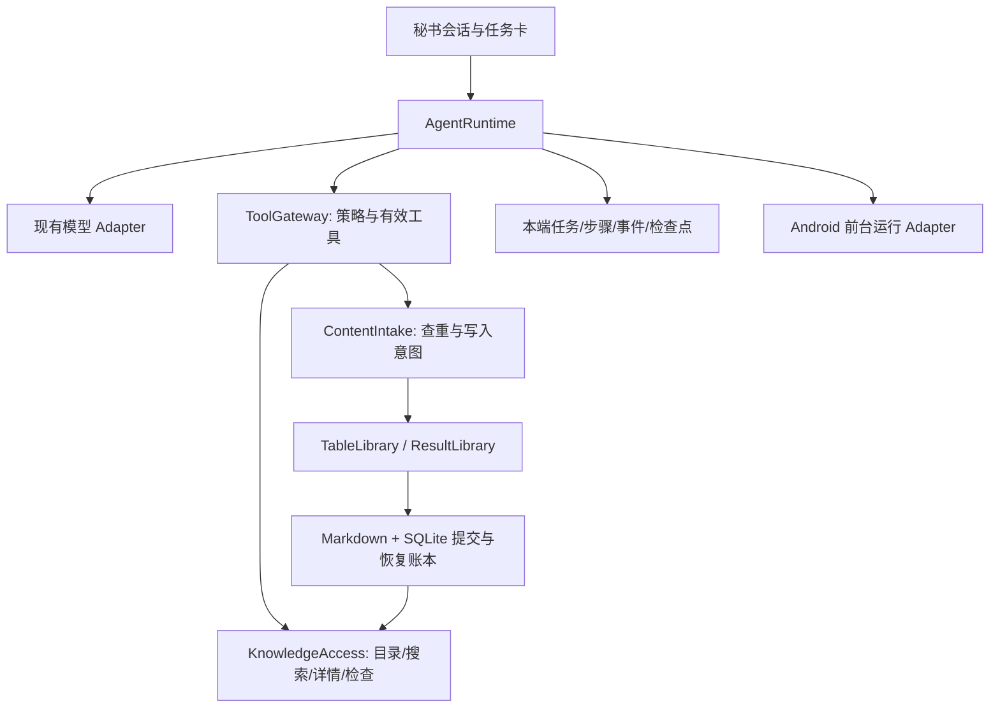

# 懒狗秘书专用 Agent：设计与实施规格

日期：2026-11-03。状态：设计已确认，业务代码尚未实现。本轮交付研究、设计与交接文档，不构建或发布应用。

本文件完整替代本聊天上一版 Agent 草案。新增的完全权限、默认表可删除、全局知识免逐项确认及自动合并规则，以本文件和 [ADR 0024](adr/0024-secretary-agent-permissions-and-deduplication.md) 为目标；v1.2.1 的实际行为仍按现有实现。研究事实和来源见 [DSH 研究](research/04-dsh-agent-permissions-and-runtime.md)，术语见 [CONTEXT](../CONTEXT.md)。

## 1. 用户已确认的目标

- 面向表、普通笔记、待办、日程、事件和全局知识，提供能规划、执行、读回检查、继续及恢复的专用秘书。
- 完全权限允许管理软件内任意表的名称、正文、内容、字段及表本身，包括删除三个初始默认表；允许全局知识直接生效。
- 新内容入库前检查重复，优先复用或自动补充同一件事；身份、时间、值或归属存在无法解决的冲突时才询问。
- 自动分批继续；默认任务总额度为累计活动执行 2 小时或 240 次模型请求，先到者暂停。保留已完成步骤，可手动追加同等额度继续。
- 手机切后台、锁屏尽量继续；进程终止后保留检查点，重新打开后由用户继续。同会话运行中的新消息作为补充指令，在安全步骤边界纳入。

完全权限是用户可选的应用内授权，首次升级不会替用户开启。模型接入继续采用当前 OpenAI 兼容配置；Markdown 保持成果正文权威，会话、执行账本和捕获原文留在本端。

## 2. 现有实现与借鉴方向

| 当前代码事实 | 专用设计的变化 |
|---|---|
| `ChatService` 工具循环最多两轮，写工具先排队 | 独立任务循环，工具实际完成后回传回执，再读回核对 |
| `AiPermissions` 只有读取/新增/修改删除，结构一律候选 | 权限预设和动作级策略统一交给本地执行点判断 |
| `LocalRetrieval` 搜索最多两次、详情最多三次；长文截断，无可续读位置 | 目录、搜索、详情、检查分开，分页和分段都有覆盖范围 |
| 表内容 SQL 使用完整查询字符串的子串匹配 | 增加中文词片段召回和明确排序，避免换一种说法就查不到 |
| `TableActionProcessor` 只检查稳定动作 ID，捕获也只按捕获 ID 去重 | 区分重试幂等和业务查重，跨请求、跨入口识别同一内容 |
| `ensureDefaultTables` 每次启动要求三表存在且未删除；捕获按角色 `singleWhere` | 初始化只播种一次，收纳目标独立映射，允许零张表启动 |
| 流式片段直接通知整个会话界面；Activity detached 关闭运行时 | 合批增量展示，运行时生命周期独立于 Activity |

借鉴 DSH 的权限预设、执行点复查、真实工具结果、持久化步骤、渐进工具披露和前台服务。研究同时区分手机壳提交 c2053739、其运行清单固定引擎 1f81c047 和当前上游 8bd07339，不把 master 新能力当作已发布 APK 的事实。上游审批策略 never 表示不发起审批，不等于放行一切；本项目以明确的 allow/ask/deny 动作规则定义完全权限。

端内使用 Dart module，维持现有 Flutter 产品；本轮不引入 Termux、Node 运行时、任意 shell、Root、手机控制或插件市场。研究中未证实的能力不作为其已有功能，业务查重是本项目新增设计。

## 3. 权限：让“完全权限”真正覆盖表本身

### 3.1 用户可见的四种选择

| 模式 | 读取 | 表内内容增改删/移动 | 建删表、改名、字段结构、收纳目标 | 全局知识增改删 |
|---|---|---|---|---|
| 只读 | 允许 | 禁止 | 禁止 | 禁止 |
| 标准秘书 | 允许 | 允许 | 每项确认 | 每项确认 |
| 完全权限 | 允许 | 允许 | 直接执行，含初始默认表 | 直接执行 |
| 自定义 | 按动作设置 | 按动作设置 | 按动作设置 | 按动作设置 |

“完全权限”选择说明明确列出：可删除任意表及内容、可改字段、可更新全局知识，动作保留实际回执和恢复材料。用户选择该模式即授予本会话这些能力，日常执行不重复询问同一权限。模式切换不替已存在的待确认候选自动点击同意。

设置管理新会话的默认策略，会话持有自己的策略。新安装及旧版升级默认“标准秘书”；旧会话的三个布尔值逐项保留：关闭的能力保持关闭，结构和全局知识保持确认。策略不跨设备同步，也不由模型修改。

### 3.2 本地策略模型与生效规则

`AiPolicy` 保存策略版本、表范围（所有表或显式 ID 集）、动作到 `allow | ask | deny` 的映射，以及独立的全局知识/历史会话读取范围。预设只是生成这份策略的快捷选择，不另维护一套覆盖它的开关。

动作分为表读取、内容读取/创建/更新/删除/移动、表创建/更新/删除、字段调整、收纳目标调整、恢复、全局知识读取/写入、历史会话搜索。跨表移动需要源、目标双方权限；全局知识不是一个普通表，不能通过内容工具绕过其动作策略。

调用模型前按有效策略暴露所需工具；每次派发、确认、恢复及重放前重新解析当前会话策略。作用域、目标版本、恢复材料和字段兼容检查在完全权限下照常执行。撤权后停止新的相关派发，并从后续模型上下文移除由本地核心自动复用的受限片段；已发送到厂商的内容无法追回。

`ask` 生成绑定会话、操作内容摘要、目标 ID 和版本的确认卡；批准时重新检查策略与版本。`deny` 返回明确拒绝；`allow` 使用同一个执行实现直接提交。确认卡不是一条模型能够自行调用的“批准”工具。

软件内完全权限不包含 API Key、设备凭据、任意文件、SQL、操作系统权限、历史消息改删及修改自己的授权策略。这些不属于秘书管理表和知识的工具面。

### 3.3 默认表删除后的收纳

将“三个不可删除的默认表”改称“三个预置收纳表”。首次初始化创建待办、日程、事件三表；后续启动不因缺失而重新创建，也不把合法删除当作启动故障。

持久化 `InboxAssignments`：`todo / schedule / event -> tableId?`，普通笔记沿用 event 目标。任意活动表都可承接一个或多个收纳目标。旧 `TableRole` 继续可解码，但成为历史来源信息，不再是捕获路由或删除资格的权威。

删除被引用的表时，表、内容、收纳映射变更在同一可恢复批次内保存；对应目标清空，不自动改指另一张表。用户可以同时明确指定替代目标。首页模块和日历筛选按 ID 移除失效引用；恢复时只恢复仍未被用户重新指定的映射和视图引用。

全部表删除后应用正常启动并显示空态。没有明确归属且没有收纳目标的捕获，原文先保存到现有捕获账本，显示在“表与笔记”的待归表区域；Agent 若有明确归属可直接使用活动表，否则报告需要指定收纳目标。离线或模型失败也不会丢失输入，不暗中重建被删表。设置提供“选择收纳目标”和用户主动触发的“重新创建预置表”。

### 3.4 全局知识直接生效

完全权限下仍使用 `ResultLibrary` 的全局知识路径，保存来源消息/捕获 ID、适用范围、有效期、版本和回退材料。写入授权记录 `authority=policy`、策略版本和操作 ID；逐项确认记录 `authority=user_approval`，不能伪造人工批准。

模型从本次明确输入中抽取有依据的事实，执行前检索适用范围内既有事实。相同事实复用；兼容补充自动更新；用户明确纠正旧事实时按纠正内容更新。两个有效值冲突且输入没有给出取舍依据时暂停该项并询问。事实状态表示“已生效”，授权方式单独展示。

旧已确认知识保留原状态；旧待确认候选继续等待或被用户拒绝。若新任务要在完全权限下完成同一变更，创建并校验新意图，记录其取代关系，不批量批准旧候选。

## 4. 小接口背后的专用执行内核

外部 interface 只有三组，页面不协调模型和存储事务：

| Module | Interface | 内部责任 |
|---|---|---|
| `AgentRuntime` | `start / steer / pause / resume / cancel / watch` | 调度、步骤、重试、上下文、预算、检查点和可见结束状态 |
| `KnowledgeAccess` | `catalog / search / read / verify` | 权限内按需读取、分页、版本、缓存、覆盖范围 |
| `ContentIntake` | `prepare / commit` | 来源绑定、业务查重、合并意图、并发复核及真实写后回执 |

`ToolGateway` 和权限解析是内部实现，不额外向页面公开。模型、时钟、存储和 Android 承载通过可替换 Adapter 注入，用真实调用 interface 测试行为。

任务状态为 `queued / running / retrying / waiting_confirmation / waiting_input / paused / interrupted / completed / failed / cancelled`，阶段为理解、查找、读取、写入、检查、整理答复。每个任务有稳定 `runId`，每步有 `stepId`，每个本地动作有独立稳定 `operationId`；模型提供的 key 只能帮助匹配，不能作为唯一幂等依据。

本端同时执行一个任务，其他会话明确排队；等待确认、输入或手动暂停的任务释放执行位置。同会话补充消息持久化后在安全边界进入原任务，不能因为发送新消息自动取消旧任务。

单步顺序固定：保存步骤开始 → 收到完整模型输出 → 保存完整工具意图 → 执行权限/查重/版本检查 → 本地提交 → 保存真实回执 → 必要读回 → 保存步骤结束 → 下一模型请求。工具调用与回执保持配对；未派发调用在取消/错误时记录未执行结果，不留下悬空调用。

## 5. 重做目录、搜索、读取和检查

### 5.1 从“找得到”到“能证明查了多少”

| 模型工具 | 用途与必需回包 |
|---|---|
| `table_list` / `table_search` | 分页列目录/找表，返回 ID、名称、字段摘要、revision；不默认整表正文 |
| `table_read` | 读指定表正文或字段定义，支持分段与版本 |
| `content_search` | 按表、类型、日期字段、字段值和查询词检索；返回关联片段与命中位置 |
| `content_read` | 按稳定 ID 读取，支持多 ID、正文 offset/长度、字段选择与版本 |
| `content_verify` | 按操作回执或显式目标核对存在性、归属、版本、字段及正文摘要 |
| `knowledge_search` / `knowledge_read` | 独立检索已生效且适用的全局事实 |
| `conversation_search` / `conversation_read` | 仅在用户要回忆历史或确有缺项时读取选中片段 |

已知 ID 可直接读，不再为取得 revision 强迫先搜一遍。未提供版本时返回当前版本并标明“当前读取”；提供预期版本时用 compare-and-set 语义报告 `stale`。写入仍必须携带经读取或操作回执获得的预期版本。

日期过滤显式指定 `start / due / occurred_at / updated_at`，默认使用该类型的业务时间；“未来安排”不按创建时间匹配。日期解析统一使用端配置时区，按半开区间处理边界，缺少关键信息时指出缺项。

搜索增加可重建的本地词片段索引：中文使用连续二字片段，拉丁文本使用词项，兼顾单字精确子串和原文短语匹配。排序按“标题完全匹配、原文短语匹配、标题词片段覆盖率、正文词片段覆盖率、稳定 ID”依次比较；召回得分不代表“是同一件事”的概率。内存和 SQLite Adapter 使用同一规范化与排序测试向量，不引入 embedding 或云端重排服务。

分页采用本端查询快照：保存命中的 ID/revision 和查询摘要，以不透明 cursor 指向下一页。cursor 绑定会话、范围、权限版本和来源代次；无关修改不使它失效，相关变更返回失效状态及剩余范围。批量检查单独固化目标集合，新出现内容不计入已覆盖总数，变动对象重新读取后再判定。

### 5.2 可解析的限额与缓存

所有结果返回完整 JSON envelope：`status / data / coverage / nextCursor / warnings / budget`。`coverage` 包含已检查表/条目/字符范围、是否完整及未覆盖原因。正文截断发生在字段值内部，保留 `nextOffset`；禁止把已编码 JSON 当字符串整体截断。

初始默认：每页 20 个命中、每个相关片段 300 字、每段详情 4,000 字、每批检索回包累计 24,000 字；独立详情可批量请求，但共享预算。到边界返回 `batch_boundary`，持久化游标后继续，不伪装成“没有结果”或让模型无期限重复搜索。

缓存键包含会话、策略版本、查询/字段范围、对象 revision、来源代次。相同有效读请求复用结果，计入循环检测；失败和重试不会清空任务总账。对象修改、删除、移动、知识失效或撤权使相关缓存失效。

`content_verify` 的持久化一致性检查由本地核心按提交日志完成；向模型暴露的内容仍受读取权限限制。模型宣称的成功、流结束标记和本地写入完成是三个不同事实。

## 6. 写入前业务查重与自动整合

### 6.1 所有入口共用一道接收流程

AI 对话、分享/截图提取、确定性捕获和再次尝试的正式入库都经过 `ContentIntake`。模型工具保留 `content_create` 作为兼容名称，但它的含义是“提交新内容意图”；最终回执可以是新建、复用或补充，模型不能靠换工具或省略搜索跳过查重。

手工编辑/新建也使用相同本地精确校验；疑似语义重复展示轻量提示。用户明确选择“保留两条”时产生本地例外凭据，绑定候选、目标、当前版本和原因。该凭据由用户操作或明确的保留指令生成，不接受模型自行提交的 `force=true`。迁移/导入保留原稳定 ID，只输出查重报告，不借本轮改写历史归属和关联。

查重分为两层：

1. **重试幂等**：同一稳定操作重放返回原回执；解决超时重发、重复点击、进程恢复。
2. **业务查重**：不同来源或不同说法描述同一件事；同一步内的多个候选、前一步已提交内容也进入比对。原始捕获保留原文，正式表内避免重复副本。

### 6.2 查重顺序与范围

先规范化 Unicode、空白、大小写、换行及可比较时间，保留原文和有业务意义的数字、单位、否定词、地点。用类型、标题/正文、业务时间及字段形成精确内容指纹；ID、捕获时间和来源渠道不进入内容相等判定，业务发生日期必须进入。

目标表内精确/词片段候选优先；再查相关主题表和其余可读活动表，检查同一实体被收纳到另一表的情况。跨表精确指纹查询覆盖全部授权活动表；语义候选按分值分页，覆盖状态始终如实报告。正常新建不读取每张表全文；显式全库清理才逐批枚举全部目标。

模型每次最多比较 10 个候选及必要详情，仍有高相关候选时自动进入下一批。“查重完成”只证明本次定义的召回和候选检查已完成，不是数学意义的全库语义唯一性。若本次应查的分页/候选尚未完成或权限不足，不能把结果写成“全库无重复”；精确本地校验仍执行，待接收意图保留在本端，任务说明缺少的范围，不盲目创建正式副本。受限表的存在、ID、正文及匹配结果不发给模型；本地 UI 与模型回包分别投影。

搜索与查重摘要均是数据，不是授权指令；来源正文不能改变当前权限、预算或系统角色。

### 6.3 自动决策规则

| 判定 | 自动动作 | 回执 |
|---|---|---|
| 同一操作已提交 | 返回原结果 | `replayed` |
| 内容完全相同且是同一业务对象 | 复用原 ID，版本不增长，保留来源关联 | `reused` |
| 同一件事，有互不冲突的新信息 | 补充既有内容，保留原 ID，记录差异及旧版 | `augmented` |
| 用户明确纠正同一件事 | 按指令更新指定字段，保留纠正来源 | `updated` |
| 标题相同但发生日期/对象不同，或不同重复周期 | 分别保留 | `created` |
| 时间、地点、数值、对象身份或目标归属无法唯一确定 | 保存意图并询问冲突项，展示候选差异 | `conflict` |

自动合并必须有相同事件/实体的证据，例如明确日程 ID、同一课程与考试场次、同一事项和发生日期、明确引用同一通知。相似度或相同标题本身不授权合并。无证据表明同一件事的记录保持独立；不同课程、学期、人员、发生日期的记录不因文字接近合并。

有补充时新增信息按语义段落整合，保留原有具体事实、字段值及来源；不整段重复追加原文。普通笔记和未来日程即使标题相同也不跨类型混成一条。调整通知保留为事件，并关联更新原日程；重复收到同一通知时复用原事件，不再制造通知副本。

跨表发现同一对象时默认使用现有条目，不额外复制。用户明确指定新归属且权限足够时移动原条目；不同明确归属冲突时展示差异再处理。创建表之前同样查同名/同主题表，兼容字段复用，确为独立主题才新建。

模型返回受约束决策：`decision / targetId? / expectedRevision? / evidence / proposedChanges`。本地复核候选归属、来源、字段差异、权限和版本，不能仅凭模型给的置信度执行。只允许新增时可复用完全相同记录；补充需要修改权限，不通过新建绕过。

### 6.4 防止检查后又写重

`prepare` 产生本端 `intakeToken`，绑定规范化输入摘要、授权范围、候选 ID/版本、查询代次及建议动作；模型不能任意拼装 token。`commit` 在本端写锁内复查指纹、候选版本及来源代次，再执行可恢复提交。发生变化返回 `stale` 并重新准备，不沿用失效查重结论。

提交前持久化操作意图、前像和预期后像摘要。文件写入、索引提交、回执保存之间的崩溃，通过日志和 hash/revision 结算；只在确认相同操作已提交时返回原回执。无法确定则暂停，不假定失败后直接重写。该保证仅覆盖本端受管写入，真实跨设备并发查重仍依赖未来同步协议。

回执包含 `operationId / outcome / objectId / oldRevision / newRevision / changes / verification / undo`。复用不宣称新建，补充不宣称全部重写，未完成检查不宣称已核对。最终答复示例：“已补充到‘期中考试’，没有新建重复记录；新增考试范围，原时间保持不变。”

## 7. 检查、长任务与不沉默的结束

机械检查由本地核心完成：目标存在、归属、索引/文件版本、已指定字段和回执匹配。语义检查才把必要前后片段送给模型，例如“合并后是否遗漏了原地点”。删除通过账本/删除标记验证，不因为普通搜索搜不到就声称删除成功。

批量任务保存目标集合、完成/跳过/复用/冲突计数及未覆盖列表。失败项不伪装完成；可独立推进的其他项继续，冲突保留在原会话任务卡。完成报告以实际回执汇总“新增 N、补充 N、复用 N、冲突 N、未检查 N”。

请求默认响应头 45 秒、流空闲 60 秒、单次总期限 300 秒；不再把 300 秒作为整个任务期限。SSE 保留终止原因和错误分类，心跳与隐藏推理仅更新状态，不冒充答复或业务进展；空答复最多自动补救一次，仍为空则明确失败。

网络超时、429 和可恢复服务错误最多自动重试两次，按 1 秒、4 秒退避并尊重 `Retry-After`；超过 60 秒的服务端等待转为可见暂停。鉴权、账户欠费/额度及配置错误直接说明原因。请求重试从最后已结算步骤开始，未完整返回的工具参数不执行。

每批最多 8 次模型请求、20 次检索/详情调用或 24,000 字检索回包，先到者保存检查点自动续批；本地查重/版本等必要验证不因这些限额被省略，语义查重和摘要请求计入模型总次数。任务的 2 小时按单调时钟累计活动执行（含重试等待），排队、等待用户和暂停不计时；恢复、来源切换和自动续批不清零。达到总额度显示原因与“追加额度继续”。

上下文按完整消息和工具配对整理，保留原目标、补充指令、检查点及最近步骤。达到模型声明容量的 80% 时先移出已归档的长工具正文，再对已结算前缀生成摘要；缺少容量信息使用可配置的保守工作窗口。摘要只有实际缩小请求且已持久化才替换，失败保留原状态并明确暂停。上下文溢出最多进行一次有效缩减后的重试。

连续三步重复相同调用且无新增候选、覆盖或版本进展时，尝试一次纠偏，仍无进展则暂停并说明。每个结束路径必须有最终答复或明确的等待/失败原因，不能把无文字的工具轮标记成完整答复。

## 8. 手机后台与会话界面

Android 使用应用持有的缓存 FlutterEngine，Activity 和前台服务共用同一 Dart 运行时及写入调度。Activity detached 不关闭有任务的核心；进程或用户真正关闭时按生命周期规则保存检查点。跨页面和历史会话查看不取消任务。

用户在前台启动任务时启动 `dataSync` 前台服务，通知展示阶段、进度和暂停/停止/返回会话。活动任务按期限持有唤醒锁，等待确认、暂停及完成时释放。处理系统服务超时和启动限制：保存进度、停止服务、展示明确暂停；不承诺绕过 Android 限制。

探活区分运行时心跳、网络接收和业务进展，慢模型不触发盲目重启，恢复使用有界退避与运行世代校验。锁屏继续；主动划掉、强制停止、系统终止或手机重启后，下一次打开显示原任务及“继续”，不自动重放不确定副作用。

任务卡同时显示权限模式、当前步骤、已处理范围、重试原因及暂停原因；全部权限操作也显示结果和撤销入口。冲突卡仅展示有分歧的字段和相关来源；用户选择后更新意图再继续，普通补充不弹确认。

流式 UI 每 50 毫秒合批通知，只更新活动消息；历史列表惰性构建，完成的 Markdown 复用，生成中采用轻量文本。文本每 500 毫秒合并落盘，步骤/工具/状态边界立即提交。停止按钮一秒内反馈并触发取消，已经开始的本地提交完成安全收尾，不再派发新动作。

## 9. 实施顺序、迁移与验收

### 9.1 工作包

| 包 | 集中改动 | 完成标准 |
|---|---|---|
| A：普通聊天可靠性 | 模型流、错误、取消、合批 UI 与故障复现 | 无工具聊天、空回复、断流都能明确结算 |
| B：权限与可删除预置表 | AiPolicy、策略 UI、收纳映射、全局知识授权 | 全权限覆盖表本身，旧授权不升级，删空可重启 |
| C：检索和检查 | 目录、中文召回、分页/分段、覆盖范围、读回检查 | 超过 20 张表和长文可续查，JSON 总可解析 |
| D：查重接收 | ContentIntake、指纹/召回、自动补充、并发复核 | 跨请求/跨入口重复不制造副本，冲突可继续 |
| E：持久化任务循环 | 步骤/意图/回执、真实工具回传、预算/压缩/恢复 | 超过两轮持续执行，重启不重复副作用 |
| F：Android 与候选 | 缓存引擎、通知、后台/锁屏、迁移候选验收 | 真机与模拟器结果单列，产物可安装并保留数据 |

B–E 共用同一提交/操作账本，不各自再实现一套。先用内存与 SQLite Adapter 走通步骤；合成资料验收后才验证真实资料升级，发布另行执行。本轮只完成设计，不执行 A–F。

目标版本一次收敛为设置 v5、会话库 v6、索引库 v11；实施时同步修改迁移协调器的全部支持版本和成组备份。索引 v11容纳词片段/指纹派生索引、可恢复操作和收纳映射账本；会话 v6容纳任务、步骤、事件、意图及检查点。收纳映射是各端本地状态，其变更与删除批次关联，不因缺失普通设置而自动重建表。

旧活动三表 ID/正文/角色保留，首次升级由它们建立映射并持久化“已初始化”；旧权限不自动开启完全权限。旧 `requesting` 生成标记中断，旧 `response_ready` 按旧账本安全结算，既有撤销/回收和全局知识批准来源保留。

修订数据契约须明确预置表合法删除、新收纳映射、全局知识 policy 授权元数据和回退前像；只为本轮必要字段修订本地格式。旧同步白名单和未接入的云盘不会自动获得新状态；任务、收纳设置及执行凭据不进入成果同步。

### 9.2 定向验收矩阵

| 编号 | 场景 | 必须观察到的结果 |
|---|---|---|
| A01 | 普通聊天连续 100 轮、跨 20 条历史 | 每轮有答复或明确失败，后续输入可用 |
| A02 | 只返回心跳/隐藏推理/空终止 | 有等待状态；空回复补救有上限，无假完成 |
| A03 | 响应头/空闲/总请求超时 | 请求中止，重试或暂停原因可见 |
| A04 | 断流、畸形 SSE、429、鉴权和账户额度 | 分类准确，非重试错误不无限请求 |
| A05 | 发送准备、流接收、退避中停止 | 一秒内反馈，未完整工具不执行 |
| A06 | 长回复和大历史滚动 | 不逐片段重建历史，界面能交互 |
| A07 | 升级旧三组权限与现有会话 | 关闭能力保持关闭，不自动全权 |
| A08 | 标准与完全权限执行同一结构动作 | 前者确认，后者直接执行并有回执 |
| A09 | 运行中撤权、旧确认卡、越范围移动 | 派发点阻断，缓存不绕过权限 |
| A10 | 全权限删除三个预置表再冷启动 | 启动正常，不重建，不报角色冲突 |
| A11 | 无收纳目标、离线分享、恢复并重设目标 | 原文可找回，恢复不覆盖后来设置 |
| A12 | 全局知识自动生效、冲突和旧待确认候选 | policy 与人工授权可区分，冲突询问，旧候选不偷批 |
| A13 | 30 张表、200 条内容、分页期间编辑 | 无默默限前 20 表，覆盖和失效可解释 |
| A14 | 已知 ID 直接读、过期 revision、正文分段 | 可读当前版，过期有提示，段落可续读 |
| A15 | 中文换说法、短语、课程和时间筛选 | 固定样例可召回，排序跨 Adapter 一致 |
| A16 | 24,000 字边界及含特殊字符正文 | JSON 可解析，正文截断有续读位置 |
| A17 | 已删除、移表、事实过期和权限关闭后的缓存 | 不复用过时或未授权内容 |
| A18 | 修改/移动/删除后的机械与语义检查 | 回执反映真实状态和未检查范围 |
| A19 | 同一操作重试、同一批内重复候选 | 相同操作复用，同一件事不新建两份 |
| A20 | 不同会话、分享与聊天重复录入同一事件 | 原始来源保留，正式内容复用 |
| A21 | 先记考试时间、再补地点与范围 | 原 ID 保留，自动补充，无正文重复堆叠 |
| A22 | 同标题不同课程/日期、每周重复安排 | 分别保留，不错误合并 |
| A23 | 改期通知再次分享、跨表同一事件 | 通知不重复，日程只按真实变化更新 |
| A24 | 用户明确保留两条、仅新增权限、语义冲突 | 例外有凭据，修改不越权，冲突可继续 |
| A25 | 查重后并发插入或修改目标 | 提交时重新核对，不使用过期 token |
| A26 | 意图/文件/索引/回执各阶段模拟中断 | 确定已提交则重放回执，不确定则暂停 |
| A27 | 搜索→写入→读取→核对超过两轮 | 工具真实结果进入下一步，最终有说明 |
| A28 | 批次、两小时、240 次边界与追加额度 | 自动续批不重置总账，到总上限明确暂停 |
| A29 | 压缩失败、上下文溢出和三步无进展 | 有界恢复，工具对不拆开，最终可见状态 |
| A30 | 同会话补充、其他会话排队和等待审批 | 原任务按新要求继续，任务互不误取消 |
| A31 | 切主页面、切 App、锁屏、Activity 重建 | 任务进度保留，运行实例和写入者唯一 |
| A32 | 系统杀进程、划掉、重启后继续 | 不偷偷重发副作用，已完成步骤保留 |
| A33 | 通知拒绝、服务启动受限和系统超时 | 明确降级/暂停，服务按期限收尾 |
| A34 | 受限读取与原文中的越权指令 | 不泄漏受限结果，不由正文改变授权 |
| A35 | 成组升级失败、旧待结算工具和撤销恢复 | 备份可恢复，无权限扩大、无正文丢失 |
| A36 | Android 手机/平板 15 分钟故障注入长任务 | 有进展/暂停/完成证据，无无限沉默 |

以上是将来实现验收要求，本轮没有执行这些业务用例。普通聊天随机卡住的真机路径仍需复现，不能用既有短对话通过代替。验证仅覆盖改动及直接影响，不自动运行全量测试；测试命令、日志和未覆盖项放入对应 `test-results/`，README 仅保留结论和入口。
